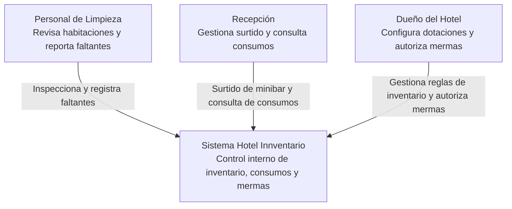
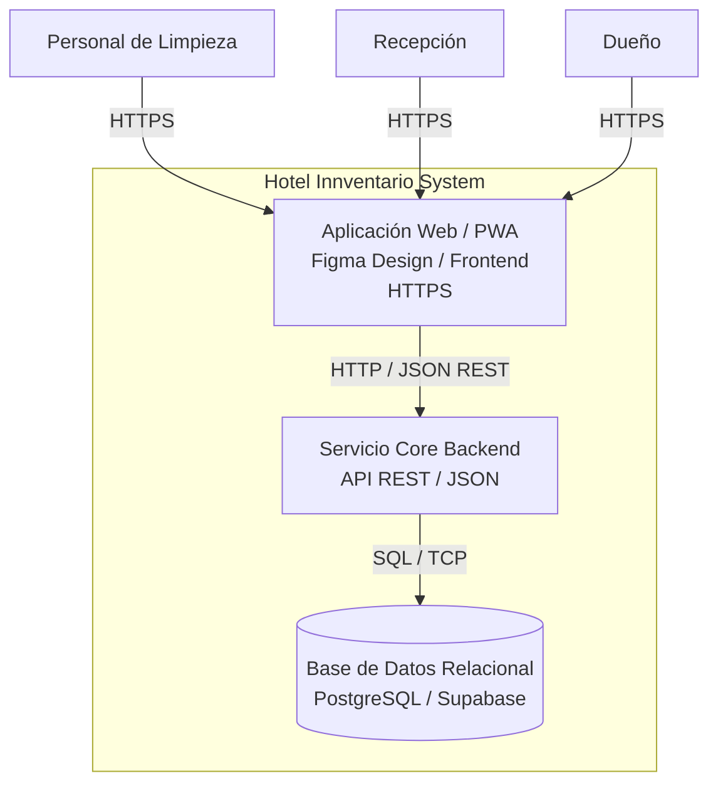
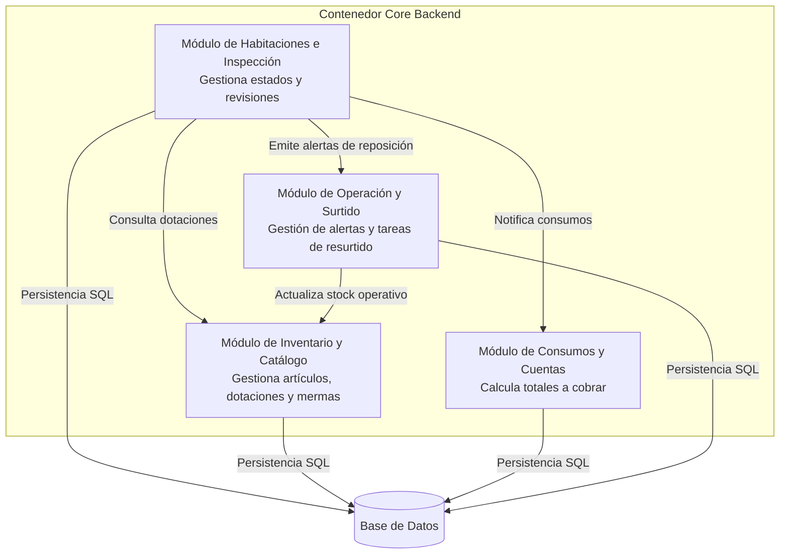

# Diagramas de Arquitectura (C4 Model) - Hotel Innventario

## 1. Diagrama de Contexto (Nivel 1)

---

## 2. Diagrama de Contenedores (Nivel 2)

---

## 3. Diagrama de Componentes (Nivel 3 - Contenedor Core Backend)

